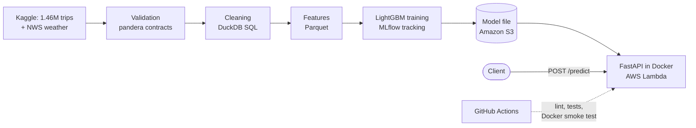
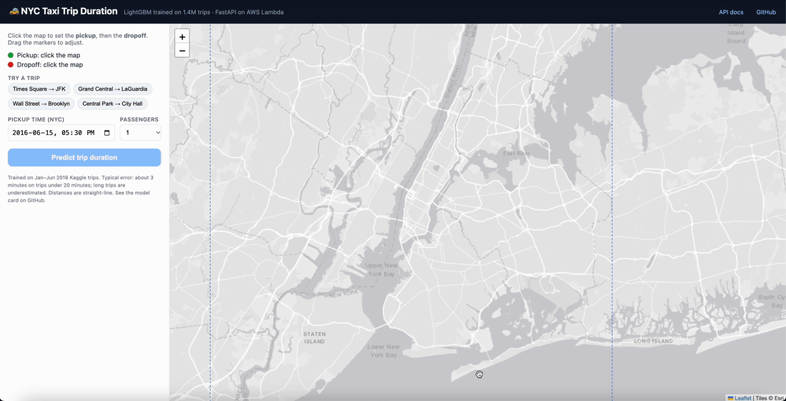
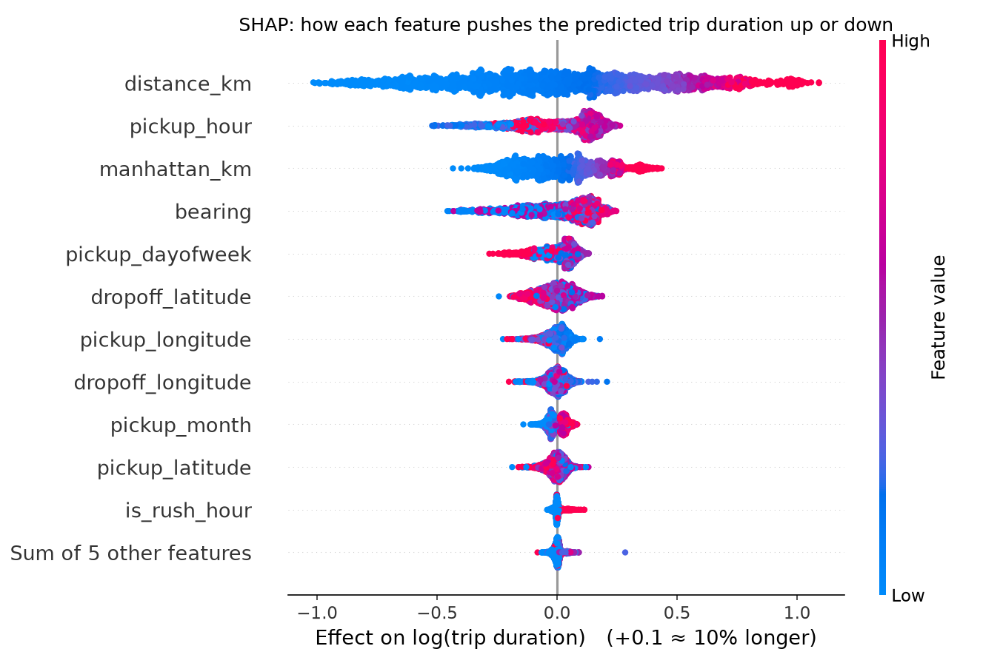
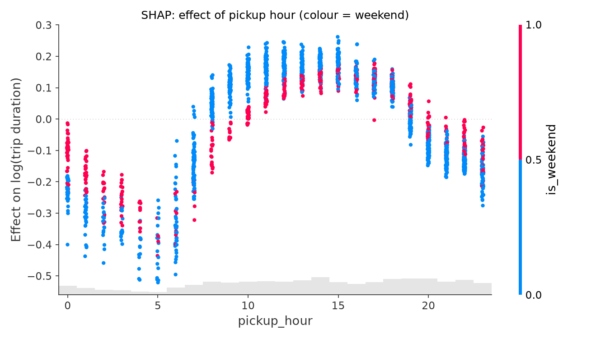
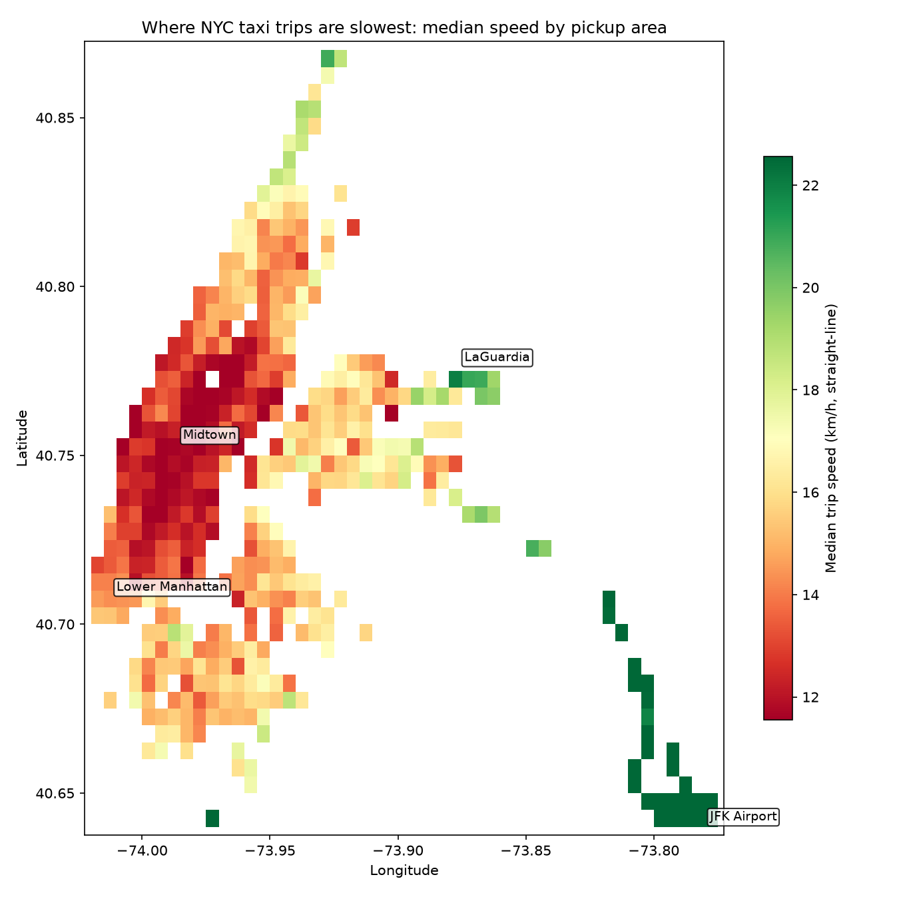
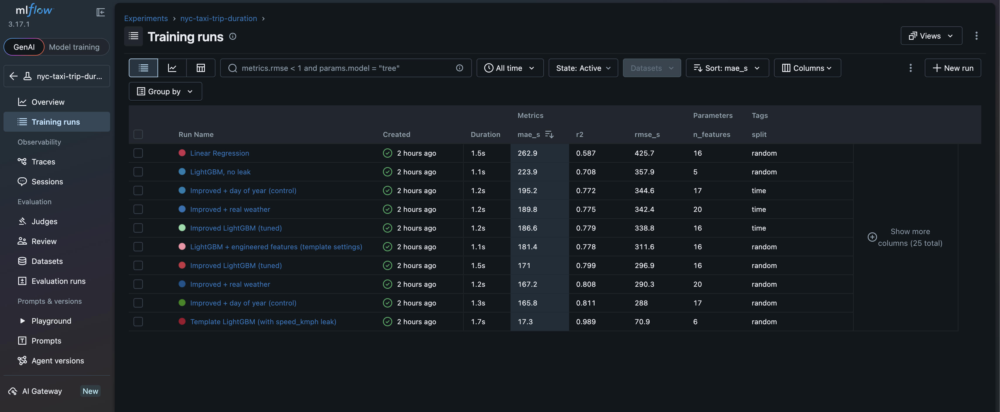

# ML Pipeline: NYC Taxi Trip Duration

[](https://github.com/Fatema-alam43/ml-pipeline-nyc-taxi-trip-duration/actions/workflows/ci.yml)

End-to-end machine learning pipeline that predicts New York City taxi trip duration from 1.46 million trips: data contracts, SQL-based ETL with DuckDB and Parquet, feature engineering, gradient boosting, automated tests with CI, honest time-based evaluation, MLflow experiment tracking, SHAP explanations, and a **prediction API on AWS Lambda** (FastAPI, Docker).


## Getting the data

The data is not stored in this repository. It is downloaded from Kaggle:

1. Create a Kaggle account, go to **Settings → API → Create New Token**, and save the downloaded `kaggle.json` to `~/.kaggle/kaggle.json`.
2. Accept the competition rules: <https://www.kaggle.com/competitions/nyc-taxi-trip-duration/rules>
3. Run:

```bash
pip install -r requirements.txt
python scripts/download_data.py
```

Files are saved to `data/raw/` and checked automatically (row counts and timestamps).

## Running the pipeline

```bash
python -m src.pipeline              # full run: all models, both splits, SHAP, map, model card
python -m src.pipeline --fast       # only the main model
python -m src.pipeline --no-mlflow  # without MLflow logging
```

One command runs every step and writes:

| Output | Location |
|---|---|
| Cleaned data and model features | `data/processed/*.parquet` |
| Trained model | `models/lgbm_improved.txt` |
| Metrics (validation, rows removed, model scores) | `reports/metrics.json` |
| Cleaning summary, model comparison, error by trip length | `reports/*.csv` |
| SQL analytics (daily KPIs, rolling averages, slowest days, weather impact, hourly patterns) | `reports/sql/*.csv` |
| Figures (incl. SHAP plots and speed map) | `reports/figures/` |
| Model card | `reports/model_card.md` |
| MLflow run history | `mlflow.db`, `mlruns/` |

All thresholds and model settings are in [`config.yaml`](config.yaml).

## Architecture



## Prediction API

**Live demo:** TODO-API-URL (`/docs` for interactive documentation)



```bash
curl -X POST https://<api-url>/predict -H "Content-Type: application/json" -d '{
  "pickup_latitude": 40.7580, "pickup_longitude": -73.9855,
  "dropoff_latitude": 40.6413, "dropoff_longitude": -73.7781,
  "pickup_datetime": "2016-06-15T17:30:00", "passenger_count": 1
}'
```
<!-- TODO-API-RESPONSE: replace with the real response from your deployed API -->
```json
{"predicted_duration_minutes": ..., "predicted_duration_seconds": ..., "straight_line_distance_km": 21.77,
 "model_version": "...", "warnings": []}
```

| Endpoint | What it does |
|---|---|
| `POST /predict` | Predicted duration for a trip (pickup/dropoff coordinates, pickup time, passengers) |
| `GET /health` | Service status and model version (git commit and SHA-256 of the model file) |
| `GET /docs` | Interactive documentation |

- **No training/serving skew:** the API computes features with the same `src/features.py` code as training, and a
  test checks that both produce identical features (values and types) for the same trips.
- **Input validation** (Pydantic): coordinates outside New York City, passenger counts outside 1–6, identical
  pickup and dropoff, unknown fields (e.g. `trip_duration`) are rejected with a clear message per field.
  Pickups outside the training months return a warning with the prediction.
- **Deployment:** the model file is stored in S3 and loaded at startup; the image runs on AWS Lambda through the
  [Lambda Web Adapter](https://github.com/awslabs/aws-lambda-web-adapter), so the same image also runs locally.
  See [docs/deploy_aws.md](docs/deploy_aws.md).

```bash
# Run locally
uvicorn api.main:app --port 8080                 # then open http://localhost:8080/docs

# Or with Docker
docker build --build-arg PYTHON_VERSION=$(cat .python-version) -t nyc-taxi-api .
docker run -p 8080:8080 -v "$(pwd)/models:/models:ro" -e MODEL_PATH=/models/lgbm_improved.txt nyc-taxi-api
```

## Results: an honest evaluation

The course version evaluated the model on a **random** split, so trips from the same days appeared in both training and test. In real use a model always predicts trips from days it has never seen, so the pipeline also evaluates a **time-based split**: train on January–May, test on June.

| Evaluation | MAE | What it shows |
|---|---|---|
| Random split (course version) | 171.0 s | Same days appear in training and test |
| Random split, June trips only | 181.6 s | Same model scored only on June: June trips are harder (trips got longer every month) |
| **Time-based split** (train Jan–May, test June) | **186.6 s** | **The realistic estimate for future trips** |

The gap between the first and last rows has two causes, separated by the middle row: June is a harder month, and the model cannot learn June's own conditions from June.

**Weather, tested honestly.** Adding daily weather looks helpful on the random split, but a *day-of-year* control (no weather at all) does just as well, because weather values also tell the model which day it is. On the time split, where days are new, neither helps:

| Evaluation | No weather | + real weather | + day of year only |
|---|---|---|---|
| Random split | 171.0 s | 167.2 s | 165.8 s |
| Time split | 186.6 s | 189.8 s | 195.2 s |

All numbers, plus known weaknesses and limits of use, are in the **[model card](reports/model_card.md)**, which the pipeline regenerates on every run.

### What drives the predictions (SHAP)



Distance dominates: long trips (red) push the prediction up, short ones (blue) down. The pickup hour comes next. The model learned the daily traffic cycle, and weekend mornings are much faster than weekday mornings:



### Where traffic is slowest



Median straight-line speed of trips by pickup area (grid computed in SQL, [`08_speed_by_area.sql`](sql/08_speed_by_area.sql)). Midtown is the slowest area; trips from the airports are the fastest. Central Park shows as a gap because there are no pickups inside it. An interactive version is saved as `reports/speed_map.html`.

### Experiment tracking (MLflow)

Every model run is logged to MLflow with its settings, scores, feature list, git commit and model file:

```bash
mlflow ui --backend-store-uri sqlite:///mlflow.db
```



## SQL layer (DuckDB)

Cleaning and analytics run as plain SQL files on [DuckDB](https://duckdb.org/), an in-process analytical database (no server needed), reading the pipeline's Parquet files directly.

| File | What it does | SQL techniques |
|---|---|---|
| [`00_macros.sql`](sql/00_macros.sql) | Haversine distance as a reusable SQL function | `CREATE MACRO` |
| [`01_clean.sql`](sql/01_clean.sql) | The 4 cleaning rules, valid trips, and a per-rule summary | CTEs, `CASE`-style flags, running total with a window function |
| [`02_views.sql`](sql/02_views.sql) | Views over the Parquet features and the weather file (unit conversion, `T` = trace) | `read_parquet`, `read_csv`, `strptime`, `LEFT JOIN`, `MEDIAN` |
| [`03_daily_kpis.sql`](sql/03_daily_kpis.sql) | Trips, median duration and speed per day | aggregation |
| [`04_rolling_7day.sql`](sql/04_rolling_7day.sql) | 7-day rolling averages and week-over-week change | `AVG() OVER (ROWS BETWEEN 6 PRECEDING ...)`, `LAG()`, named `WINDOW` |
| [`05_slowest_days.sql`](sql/05_slowest_days.sql) | Slowest days overall and per month | `RANK() OVER (PARTITION BY ...)`, `QUALIFY` |
| [`06_weather_impact.sql`](sql/06_weather_impact.sql) | Speed and trip volume on snowy, rainy and dry days | `CASE`, CTE |
| [`07_hourly_by_weekday.sql`](sql/07_hourly_by_weekday.sql) | Average duration by hour, weekdays vs weekends | `FILTER` (conditional aggregation) |
| [`08_speed_by_area.sql`](sql/08_speed_by_area.sql) | Median speed on a grid of pickup areas (for the map) | `FLOOR` binning, `HAVING` |

**Verified against pandas:** every run re-applies the cleaning rules in pandas and checks that SQL keeps exactly the same rows, in the same order, with bit-identical distances.

Query results are written to `reports/sql/`.

### Storage: CSV vs Parquet

```bash
python scripts/benchmark_storage.py
```

Parquet files are 3–4x smaller than CSV, load about 55–60x faster in pandas, and query about 30–40x faster in DuckDB:

| Dataset | CSV | Parquet | Size | pandas load (CSV → Parquet) | DuckDB query (CSV → Parquet) |
|---|---|---|---|---|---|
| Raw trips | 200.6 MB | 48.0 MB | 4.2x smaller | 1.48 s → 0.02 s (62.5x faster) | 0.17 s → 0.006 s (29.0x faster) |
| Engineered features | 175.0 MB | 59.6 MB | 2.9x smaller | 1.41 s → 0.03 s (55.7x faster) | 0.229 s → 0.006 s (39.4x faster) |

## Project structure

```
├── config.yaml              # paths, validation and cleaning thresholds, model settings
├── pyproject.toml           # pytest and ruff settings
├── .github/workflows/ci.yml # lint + tests on every push
├── scripts/
│   ├── download_data.py     # downloads and verifies the raw data from Kaggle
│   ├── benchmark_storage.py # CSV vs Parquet: size, load time, query time
│   ├── make_test_fixtures.py# generates the synthetic test data
│   ├── make_demo_model.py   # small model on synthetic data (tests and CI)
│   └── pin_api_requirements.py # pins the API image to the training package versions
├── src/
│   ├── config.py            # loads config.yaml
│   ├── db.py                # runs the SQL files with DuckDB
│   ├── etl.py               # load, validate, clean (SQL, verified against pandas)
│   ├── schemas.py           # data contracts (pandera) for raw, clean and feature data
│   ├── features.py          # feature engineering (16 features, no target leakage)
│   ├── train.py             # random and time-based splits, models, evaluation
│   ├── tracking.py          # MLflow experiment tracking
│   ├── explain.py           # SHAP explanations
│   ├── model_card.py        # writes reports/model_card.md
│   ├── plots.py             # figures, including the speed map
│   └── pipeline.py          # runs everything: python -m src.pipeline
├── sql/                     # DuckDB SQL: cleaning, views and 6 analysis queries
├── tests/                   # 66 pytest tests + synthetic fixtures
├── api/                     # FastAPI prediction service (main.py, schemas.py, model.py)
├── Dockerfile               # API image (runs locally, on ECS and on AWS Lambda)
├── deploy/                  # AWS Lambda deploy and teardown scripts
├── docs/deploy_aws.md       # deployment guide
├── examples/                # sample API request
├── notebooks/               # exploration
└── reports/figures/         # generated figures
```

## Data quality and testing

**Data contracts** ([`src/schemas.py`](src/schemas.py), using [pandera](https://pandera.readthedocs.io/)) are checked at every stage of the pipeline:

| Stage | Contract |
|---|---|
| Raw file | Exact columns and types, unique ids, valid vendor and flag values, plausible coordinates, positive durations. Also rejects a file with exactly 1,048,575 rows (Excel's row limit) and timestamps whose dropoff − pickup ≠ trip duration (seconds lost in Excel) |
| Clean data | Every row satisfies every cleaning rule (duration, distance, NYC area, passengers) |
| Features | The 16 expected features with valid ranges, no rush hour on weekends, and **no leaky columns** (`speed_kmph`, `dropoff_datetime`) |

**Automated tests** (84 tests, about 10 seconds, run with `pytest`):

- haversine distance against known distances (Empire State Building → Times Square ≈ 1.07 km)
- each cleaning rule on hand-made trips, including values exactly on the limits (e.g. 60 s, longitude −73.7) that must be kept
- exact cleaning counts on a synthetic sample with planted problems, and SQL vs pandas giving identical results
- feature logic (compass bearing, rush hour, airport trips) and the leakage guard
- the time-based split (no day appears in both training and test), and SHAP values adding up exactly to each prediction
- every SQL analysis query, and the whole pipeline end to end, including MLflow logging and the model card
- the API: predictions, every validation rule, timezone handling, loading the model from S3, and
  training/serving parity

Tests use **synthetic data** ([`scripts/make_test_fixtures.py`](scripts/make_test_fixtures.py)), so no Kaggle data is stored in the repository and every expected count is known exactly.

**Continuous integration:** [GitHub Actions](.github/workflows/ci.yml) runs the linter ([ruff](https://docs.astral.sh/ruff/)) and all tests on every push, using the exact package versions in `requirements-lock.txt`, then builds the Docker image, starts it, and checks that it returns a prediction. Changing a single cleaning rule from `<` to `<=` makes 5 tests fail.

```bash
pip install -r requirements-dev.txt
ruff check .
pytest
```

## Data sources

- [NYC Taxi Trip Duration](https://www.kaggle.com/competitions/nyc-taxi-trip-duration) – Kaggle competition data
- [Weather data in New York City – 2016](https://www.kaggle.com/datasets/mathijs/weather-data-in-new-york-city-2016) – Central Park station, US National Weather Service

## Background

This project started as a group assignment for SEP 6DA3 (Data Analytics and Big Data) at McMaster University. This repository is my independent extension of that work, published with the instructor's permission.

## License

Code: MIT. The data is subject to Kaggle's terms and is not redistributed here.
