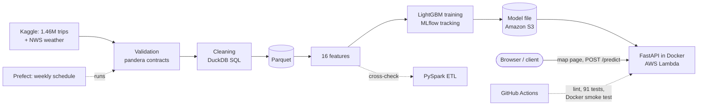
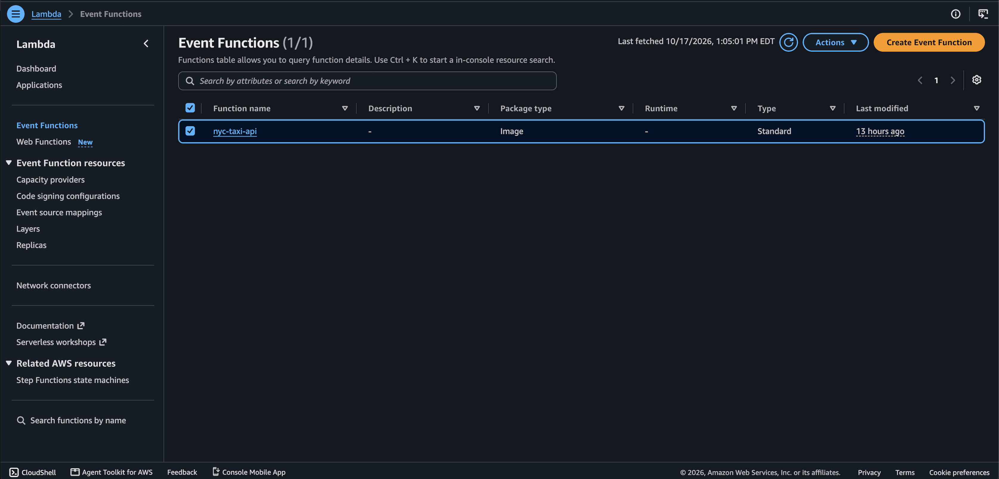
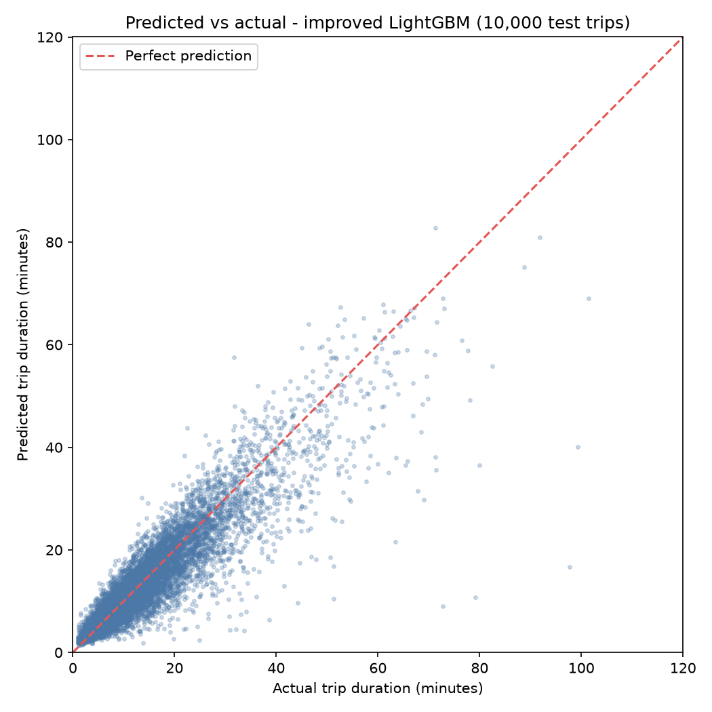
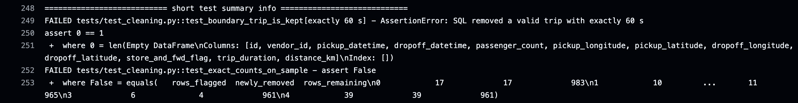
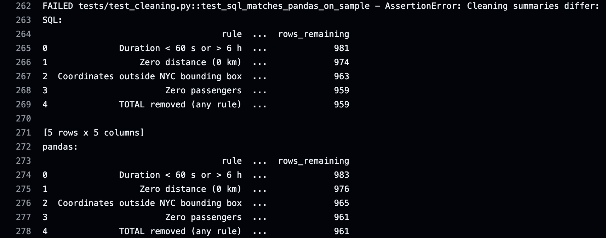
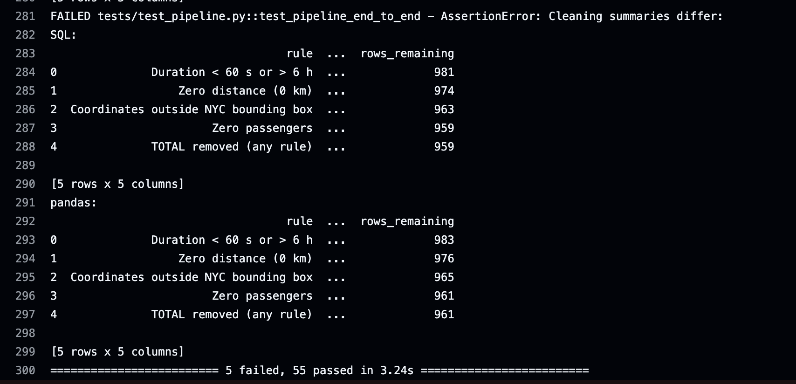
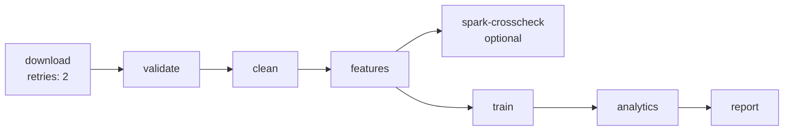
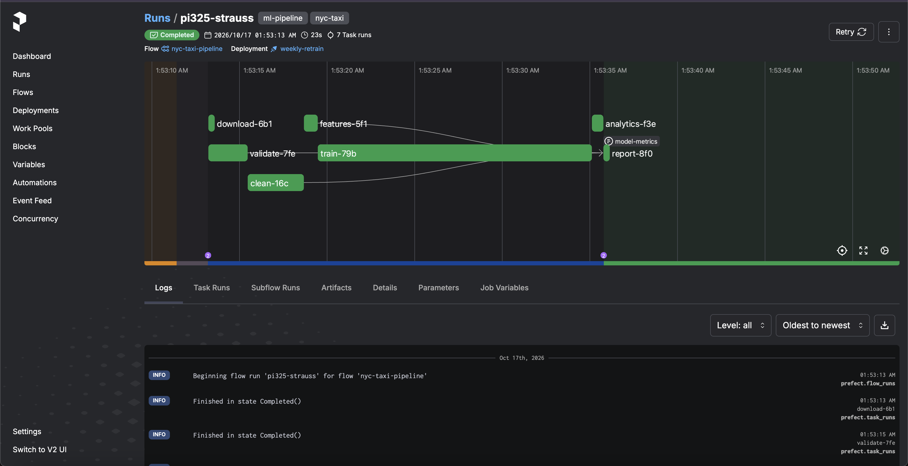
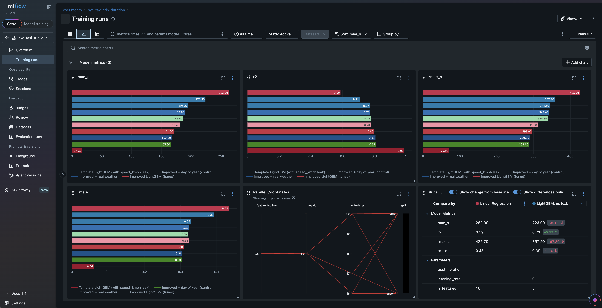

# NYC Taxi Trip Duration: an end-to-end, tested ML pipeline on AWS

[](https://github.com/Fatema-alam43/ml-pipeline-nyc-taxi-trip-duration/actions/workflows/ci.yml)


**Predicts how long a New York City taxi trip will take, from information known at pickup.** Trained on 1.44 million cleaned trips: **MAE 171 s (R² 0.80)** on a random test split and **187 s on an honest time-based split** (train January–May, test June), a **23.6% lower error** than the leak-free baseline. Served as a live API and interactive map on AWS Lambda.

**[▶ Live demo](https://ifksrlyyuqede7xad4naehovee0qrlno.lambda-url.ca-central-1.on.aws/)**: click two points on a map of NYC and get a predicted trip time · [API docs](https://ifksrlyyuqede7xad4naehovee0qrlno.lambda-url.ca-central-1.on.aws/docs) · [Interactive speed map](https://fatema-alam43.github.io/ml-pipeline-nyc-taxi-trip-duration/reports/speed_map.html) · [Model card](reports/model_card.md)


---

## Contents

1. [Project overview](#project-overview)
2. [Architecture](#architecture)
3. [Key findings](#key-findings)
4. [Results](#results)
5. [Quickstart](#quickstart)
6. [Prediction API](#prediction-api)
7. [User stories and acceptance criteria](#user-stories-and-acceptance-criteria)
8. [Data quality and testing](#data-quality-and-testing)
9. [SQL layer, Spark and orchestration](#sql-layer-spark-and-orchestration)
10. [Experiment tracking](#experiment-tracking)
11. [Limitations](#limitations)
12. [Future work](#future-work)
13. [Project structure](#project-structure)
14. [Data sources and background](#data-sources-and-background)

---

## Project overview

**The problem.** Ride-hailing, dispatch and logistics teams need to know how long a trip will take before it starts, to plan vehicles, quote arrival times and spot unusual delays.

**The data.** 1,458,644 NYC yellow-taxi trips from January–June 2016 (Kaggle), plus daily Central Park weather from the US National Weather Service.

**What this project does**, from raw file to deployed service:

| Stage | What happens | Tools |
|---|---|---|
| Validate | Data contracts reject malformed or truncated files before anything else runs | pandera |
| Clean | 4 rules remove 15,704 invalid trips (1.08%); verified identical between SQL and pandas | DuckDB SQL, Parquet |
| Features | 16 leak-free features known at pickup: distances, compass bearing, time, location, airports | pandas, PySpark (cross-check) |
| Train | LightGBM on log duration; 10 experiments per run, including an honest time-based split | LightGBM, scikit-learn, MLflow |
| Explain | What drives each prediction, and where traffic is slowest | SHAP, DuckDB, folium |
| Serve | Validated REST API and an interactive map page | FastAPI, Docker, AWS Lambda, S3, ECR |
| Automate | Every push linted, tested and Docker-checked; the pipeline runs weekly as a DAG | GitHub Actions, pytest, Prefect |

**Roles this project demonstrates:** data science (feature engineering, leakage detection, honest evaluation, explainability), ML engineering (API, Docker, AWS, MLflow, CI/CD) and data engineering (SQL ETL, data contracts, Parquet, Spark, orchestration).

---

## Architecture



The same Docker image runs locally, in CI and on AWS Lambda (through the [Lambda Web Adapter](https://github.com/awslabs/aws-lambda-web-adapter)). The model is stored in S3 and loaded at startup; the image is stored in Amazon ECR and runs on arm64 (Graviton) in the Canada (Central) region.


*The `nyc-taxi-api` function in the AWS Lambda console, deployed as a container image (package type: Image).*

---

## Key findings

- **A "near-perfect" baseline was leaking the answer.** The starter model scored **MAE 17 s (R² 0.99)** because its `speed_kmph` feature was computed from the trip duration itself. Removing it gives the honest baseline: **MAE 224 s**. A test and a data contract now make sure no column derived from the target can reach the model or the API.
- **An Excel-damaged file was caught and turned into a guardrail.** An early copy of the data had exactly **1,048,575 rows** (Excel's row limit): about 410,000 trips were silently missing and every timestamp had lost its seconds. The pipeline now rejects any file with that row count, or whose dropoff − pickup times don't match the recorded duration.
- **23.6% lower error from features and tuning.** MAE fell from 223.9 s to **171.0 s**: engineered features (Manhattan distance, compass bearing, airports, rush hour) gave −42.5 s; hyperparameter tuning gave −10.4 s.
- **The January 2016 blizzard shows clearly in the data.** The **two slowest days of the six months were 25 and 26 January** (27 January tied for third), just after 69 cm of snow fell on 23 January, with 23–48 cm still on the ground. Days with snow on the ground had about **16% fewer trips**; rainy days were not slower at all.
- **Weather looked useful but wasn't.** On a random split, adding weather improved MAE (171.0 → 167.2 s), but a *day-of-year* column with no weather did even better (165.8 s): the model was recognising individual days. On the honest time split, both made it **worse** (186.6 → 189.8 and 195.2 s), so weather is not used by the model.

---

## Results

### Model comparison (random split, 72,147 test trips)

| Model | Features | MAE (s) | RMSE (s) | RMSLE | R² |
|---|---|---|---|---|---|
| Template LightGBM (leaks the target) | 6 | 17.3 | 70.9 | 0.0603 | 0.989 |
| LightGBM, no leak (honest baseline) | 5 | 223.9 | 357.9 | 0.3934 | 0.708 |
| + engineered features | 16 | 181.4 | 311.6 | 0.3230 | 0.778 |
| **Improved LightGBM (tuned)** | **16** | **171.0** | **296.9** | **0.3103** | **0.799** |
| Linear Regression | 16 | 262.9 | 425.7 | 0.4332 | 0.587 |

### Honest evaluation: time-based split

A random split lets the same days appear in training and test. In real use the model always predicts *future* trips, so it is also trained on January–May and tested on June:

| Evaluation | MAE | What it shows |
|---|---|---|
| Random split | 171.0 s | Same days in training and test |
| Random split, June trips only | 181.6 s | June trips are harder: trips got longer every month |
| **Time-based split** (train Jan–May, test June) | **186.6 s** | **The realistic estimate for future trips** |

About two-thirds of the gap (+10.6 s) comes from June being a harder month, one-third (+5.0 s) from the model never having seen June.

| Weather experiment | No weather | + real weather | + day of year only |
|---|---|---|---|
| Random split | 171.0 s | 167.2 s | 165.8 s |
| Time split | 186.6 s | 189.8 s | 195.2 s |

### Where the model is accurate, and where it isn't

| Actual trip length | Share of trips | Average error | Bias |
|---|---|---|---|
| Under 20 minutes | 80% | 1.2–2.6 min | about 0 |
| 30–60 minutes | 6.9% | 7.9 min | −5.2 min |
| Over 1 hour | 0.7% | 21.6 min | **−20.6 min** (underestimated) |

| What drives the predictions (SHAP) | Where traffic is slowest |
|---|---|
|  |  |
| Distance dominates; the pickup hour comes next. | Median trip speed by pickup area: Midtown is slowest, airport trips fastest; Central Park shows as a gap. |

| Daily traffic cycle the model learned | Predicted vs actual (10,000 test trips) |
|---|---|
|  |  |
| Pickups at 5 a.m. are predicted about a third faster, midday about 20% slower; weekend mornings have no rush hour. | Accurate up to about 30 minutes; the longest trips fall below the diagonal. |

Full details, including the cleaning summary and known weaknesses: **[model card](reports/model_card.md)** (regenerated on every pipeline run).

---

## Quickstart

```bash
git clone https://github.com/Fatema-alam43/ml-pipeline-nyc-taxi-trip-duration.git && cd ml-pipeline-nyc-taxi-trip-duration
python -m venv .venv && source .venv/bin/activate && pip install -r requirements.txt
python scripts/download_data.py && python -m src.pipeline
```

`download_data.py` needs a Kaggle API token in `~/.kaggle/kaggle.json` and the [competition rules](https://www.kaggle.com/competitions/nyc-taxi-trip-duration/rules) accepted. The pipeline takes a few minutes and writes the cleaned data, features, model, metrics, figures and model card. Other options:

```bash
python -m src.pipeline --fast           # only the main model
python -m src.pipeline --spark-check    # plus the PySpark cross-check (needs Java 17 or 21)
python -m flows.pipeline_flow           # run as a Prefect flow
uvicorn api.main:app --port 8080        # API and map page at http://localhost:8080
pytest                                  # 91 tests
```

---

## Prediction API

**Live:** https://ifksrlyyuqede7xad4naehovee0qrlno.lambda-url.ca-central-1.on.aws/ (map page) · `/docs` (interactive documentation)

```bash
curl -X POST https://ifksrlyyuqede7xad4naehovee0qrlno.lambda-url.ca-central-1.on.aws/predict \
  -H "Content-Type: application/json" -d '{
  "pickup_latitude": 40.7580, "pickup_longitude": -73.9855,
  "dropoff_latitude": 40.6413, "dropoff_longitude": -73.7781,
  "pickup_datetime": "2016-06-15T17:30:00", "passenger_count": 1
}'
```
```json
{"predicted_duration_minutes": 82.8, "predicted_duration_seconds": 4970.5, "straight_line_distance_km": 21.77,
 "model_version": "c1763ba", "warnings": []}
```

Invalid requests get a clear message for every problem at once:

```json
{"error": "Invalid trip request", "details": [
  {"field": "pickup_latitude", "message": "pickup_latitude 42.5 is outside New York City (allowed 40.5 to 41.0)"},
  {"field": "passenger_count", "message": "Input should be less than or equal to 6"}]}
```

| Endpoint | What it does |
|---|---|
| `GET /` | Interactive map: click pickup and dropoff, see the prediction and the same trip at five times of day |
| `POST /predict` | Predicted duration (minutes and seconds), straight-line distance, model version, warnings |
| `GET /health` | Status, model version (git commit), SHA-256 of the model file, where it was loaded from |
| `GET /docs` | Interactive API documentation |

- **No training/serving skew:** the API computes features with the same `src/features.py` code as training, and a test checks that both produce identical values and data types for the same trips.
- **Input validation (Pydantic):** coordinates outside NYC, passenger counts outside 1–6, identical pickup and dropoff, and unknown fields (such as `trip_duration`) are rejected. Pickups outside the training months return a warning.
- **Operations:** one JSON log line per request in CloudWatch, a request ID on every response, a non-root container, a model fingerprint in `/health`, and a minimal IAM role that can only read the model file. Deploy and teardown scripts: [`deploy/`](deploy/), guide: [`docs/deploy_aws.md`](docs/deploy_aws.md).

```bash
# Run with Docker
docker build --build-arg PYTHON_VERSION=$(cat .python-version) -t nyc-taxi-api .
docker run -p 8080:8080 -v "$(pwd)/models:/models:ro" -e MODEL_PATH=/models/lgbm_improved.txt nyc-taxi-api
```

---

## User stories and acceptance criteria

Each criterion is checked by an automated test or a measured result.

**1. As a dispatcher, I want an estimated trip time before the trip starts, so that I can plan vehicles and tell customers when they will arrive.**
- ✅ `POST /predict` returns minutes from pickup and dropoff coordinates, pickup time and passengers, and nothing that is only known after the trip
- ✅ Typical error under 3 minutes on the 80% of trips shorter than 20 minutes
- ✅ Available on a public HTTPS URL, with the model version in every response

**2. As an API user, I want clear errors for invalid input, so that I can fix my request instead of receiving a meaningless prediction.**
- ✅ Coordinates outside NYC, passenger counts outside 1–6 and identical pickup/dropoff return HTTP 422 with one message per field
- ✅ Unknown fields are rejected, so the target (`trip_duration`) cannot be sent to the model
- ✅ Pickups outside the training period return a warning with the prediction

**3. As a data engineer, I want bad input data to stop the pipeline, so that a corrupted file never reaches the model.**
- ✅ A file with exactly 1,048,575 rows (Excel-truncated) is rejected
- ✅ Timestamps whose dropoff − pickup differs from the recorded duration are rejected
- ✅ Schema, type and value contracts are checked on raw, clean and feature data
- ✅ SQL and pandas cleaning give identical rows, order and distances on every run

**4. As a data scientist, I want an honest estimate of performance on future trips, so that stakeholders are not misled by optimistic numbers.**
- ✅ Leaky features are detected, removed and blocked by a test
- ✅ A time-based split (train January–May, test June) is reported next to the random split
- ✅ Extra data sources (weather) are tested against a control (day of year) before being adopted

**5. As an ML engineer, I want reproducible, traceable experiments, so that any result can be explained and re-created.**
- ✅ Every run is logged to MLflow with parameters, metrics, feature list, git commit and model file
- ✅ Package versions are pinned; the API image uses the same versions as training
- ✅ One command (`python -m src.pipeline`) reproduces all results, and the model card regenerates itself

**6. As a team lead, I want every change tested automatically, so that a mistake is caught before it is deployed.**
- ✅ GitHub Actions runs the linter, 91 tests and a Docker build-and-request check on every push
- ✅ Changing one cleaning rule from `<` to `<=` makes 5 tests fail (see [Data quality and testing](#data-quality-and-testing))

**7. As an operations owner, I want the pipeline to run on a schedule and recover from failures, so that the model stays current without manual work.**
- ✅ A Prefect flow runs weekly (Mondays 06:00, Toronto time); the download step retries automatically
- ✅ Each step reads and writes files, so a failed run can be resumed from the failed step

---

## Data quality and testing

**Data contracts** ([`src/schemas.py`](src/schemas.py), pandera):

| Stage | Contract |
|---|---|
| Raw file | Exact columns and types, unique ids, valid vendor and flag values, plausible coordinates, positive durations; rejects Excel-truncated files and damaged timestamps |
| Clean data | Every row satisfies every cleaning rule |
| Features | The 16 expected features with valid ranges, no rush hour on weekends, and no leaky columns |

**Cleaning rules** (all 1,458,644 raw trips):

| Rule | Flagged | Newly removed |
|---|---|---|
| Duration under 60 s or over 6 h | 10,656 | 10,656 |
| Zero distance | 5,897 | 4,219 |
| Coordinates outside NYC | 997 | 813 |
| Zero passengers | 60 | 16 |
| **Total** | | **15,704 (1.08%)** |

**91 automated tests** (`pytest`, about a minute), on synthetic test data with planted problems, so no Kaggle data is stored in the repository and every expected count is known exactly:

- haversine distance against known distances (Empire State Building → Times Square ≈ 1.07 km)
- each cleaning rule, including values exactly on the limits (60 s, longitude −73.7) that must be kept
- data contracts, the leakage guard, feature logic, every SQL query, the time-based split and SHAP values
- the API: predictions, validation, timezones, loading the model from S3, and training/serving parity
- the PySpark ETL, a full Prefect flow run, and the whole pipeline end to end

**CI catches real mistakes.** Changing a single character in the SQL duration rule (`<` to `<=`) makes 5 tests fail, each naming the problem:



| SQL and pandas disagree (959 vs 961 trips kept) | The whole pipeline stops: 5 failed, 55 passed |
|---|---|
|  |  |

The SQL rule wrongly removed the 2 planted trips of exactly 60 seconds. The test for that boundary failed, and so did the independent pandas cross-check and the end-to-end pipeline test, so the mistake could not reach the model.

---

## SQL layer, Spark and orchestration

**DuckDB SQL** ([`sql/`](sql/)) runs the cleaning and the analytics directly on Parquet files: CTEs, window functions (running totals, 7-day rolling averages, `LAG`), `RANK() OVER (PARTITION BY ...)` with `QUALIFY`, conditional aggregation with `FILTER`, and a reusable haversine macro.

**Parquet vs CSV:**

| Dataset | CSV | Parquet | Size | pandas load | DuckDB query |
|---|---|---|---|---|---|
| Raw trips | 200.6 MB | 48.0 MB | 4.2x smaller | 62.5x faster | 29.0x faster |
| Engineered features | 175.0 MB | 59.6 MB | 2.9x smaller | 55.7x faster | 39.4x faster |

**PySpark** ([`src/spark_etl.py`](src/spark_etl.py)) re-implements the cleaning and features for data too large for one machine. On all 1,458,644 trips it removes **exactly the same 15,704 rows per rule**, keeps the same 1,442,940 trips and produces bit-identical values for 15 of the 16 features. The compass bearing differs in 2 rows by 0.0000076°, because Java and NumPy trigonometry can differ in the last bit on Apple Silicon, so it is compared within 0.001°. Two details had to match exactly: coordinates are compared as 32-bit floats (a 64-bit limit would wrongly exclude longitude −73.7), and Spark counts weekdays from Sunday = 1 while pandas uses Monday = 0. On a single laptop DuckDB is faster; Spark pays off on a cluster.

**Prefect** ([`flows/pipeline_flow.py`](flows/pipeline_flow.py)) runs the pipeline as a scheduled DAG, every Monday at 06:00 Toronto time:





---

## Experiment tracking

Every model run is logged to **MLflow** with its parameters, metrics, feature list, git commit and model file (10 runs per pipeline run: baselines, the tuned model, Linear Regression, and weather experiments on both splits).

```bash
mlflow ui --backend-store-uri sqlite:///mlflow.db --port 5001
```




---

## Limitations

- **Old, short period.** Trained on January–June 2016 only. Seasons outside those months were never seen, and traffic in NYC has changed since 2016 (ride-hailing growth, congestion pricing).
- **Long trips are underestimated.** Trips over an hour are predicted about 21 minutes too short on average. They are rare (0.7%), and their causes (accidents, detours, waiting) are not in the data.
- **No live conditions.** The model knows nothing about weather, events, road closures or current traffic; it should not be relied on in situations like the January 2016 blizzard.
- **Straight-line distances.** Haversine and Manhattan distances, not the actual road route.
- **Random-split headline number.** The tuned model is evaluated on a random split for comparability with the course version; the realistic expected error for future trips is the time-split MAE (186.6 s).
- **Point predictions only.** No uncertainty range is given with a prediction.
- **Demo-level API security.** The live API is public with no authentication or rate limiting (usage is capped by Lambda concurrency and a budget alert), and the first request after a quiet period takes a few seconds (cold start).
- **Deployment from a local machine.** AWS deployment runs from a laptop with long-lived access keys rather than from CI with short-lived credentials.
- **Library compatibility.** PySpark 4.2 does not yet officially support pandas 3; results are verified by the Spark/pandas parity tests.

## Future work

- **Better accuracy:** road distances and travel times from a routing engine (e.g. OSRM), hourly weather and event data, and quantile models that return a time range instead of a single number.
- **Honest model selection:** rolling time-based validation (backtesting over several months) to choose features and settings, and retraining on the most recent data.
- **More, newer data:** the full NYC TLC trip records (billions of trips, through recent years) with the Spark pipeline on a cluster (AWS EMR or Databricks).
- **MLOps:** MLflow model registry with champion/challenger promotion, and monitoring of input drift and prediction error from the API logs.
- **Secure, automated deployment:** deploy from GitHub Actions using OIDC short-lived credentials and a least-privilege IAM role (no long-lived access keys), with infrastructure as code (AWS SAM or Terraform).
- **Production API:** authentication and rate limiting (API Gateway), batch predictions, and provisioned concurrency to avoid cold starts.
- **Orchestration:** an Airflow version of the DAG, and running the Prefect flow on a server instead of a laptop.

---

## Project structure

```
├── README.md
├── config.yaml                  # paths, validation and cleaning thresholds, model settings
├── requirements.txt             # main packages (requirements-lock.txt: exact versions)
├── requirements-api.txt         # API image packages, pinned to the training versions
├── requirements-dev.txt         # pytest, ruff, httpx
├── pyproject.toml               # pytest and ruff settings
├── Dockerfile                   # API image (runs locally, in CI and on AWS Lambda)
├── .github/workflows/ci.yml     # lint + tests + Docker smoke test on every push
├── src/
│   ├── config.py                # loads config.yaml
│   ├── etl.py                   # load, validate, clean (SQL, verified against pandas)
│   ├── schemas.py               # pandera data contracts (raw, clean, features)
│   ├── features.py              # 16 features, shared by training and the API
│   ├── db.py                    # runs the SQL files with DuckDB
│   ├── train.py                 # random and time-based splits, models, evaluation
│   ├── tracking.py              # MLflow experiment tracking
│   ├── explain.py               # SHAP explanations
│   ├── plots.py                 # figures and speed maps
│   ├── model_card.py            # writes reports/model_card.md
│   ├── spark_etl.py             # PySpark version of cleaning + features
│   ├── steps.py                 # the pipeline steps (each reads and writes files)
│   └── pipeline.py              # runs everything: python -m src.pipeline
├── sql/                         # DuckDB: cleaning, views, 6 analysis queries
├── flows/pipeline_flow.py       # scheduled Prefect flow (the pipeline as a DAG)
├── api/
│   ├── main.py                  # FastAPI app: /, /predict, /health
│   ├── schemas.py               # request validation (Pydantic)
│   ├── model.py                 # loads the model from a file or S3
│   └── static/index.html        # interactive map page
├── deploy/                      # AWS Lambda deploy and teardown scripts
├── docs/deploy_aws.md           # deployment guide
├── scripts/
│   ├── download_data.py         # downloads and verifies the Kaggle data
│   ├── benchmark_storage.py     # CSV vs Parquet benchmark
│   ├── make_test_fixtures.py    # synthetic test data with planted problems
│   ├── make_demo_model.py       # small model for tests and CI
│   └── pin_api_requirements.py  # pins the API image to training versions
├── tests/                       # 91 pytest tests + synthetic fixtures
├── examples/                    # sample API request
└── reports/
    ├── model_card.md            # generated model card
    ├── metrics.json             # generated metrics
    ├── speed_map.html           # interactive speed map
    └── figures/                 # SHAP, map, results, CI, MLflow, Prefect, AWS
```

---

## Data sources and background

- [NYC Taxi Trip Duration](https://www.kaggle.com/competitions/nyc-taxi-trip-duration) (Kaggle competition data, January–June 2016)
- [Weather data in New York City – 2016](https://www.kaggle.com/datasets/mathijs/weather-data-in-new-york-city-2016) (Central Park station, US National Weather Service)

The data is downloaded by `scripts/download_data.py` and is not stored in this repository.


**License:** code under MIT. The data is subject to Kaggle's terms and is not redistributed.
